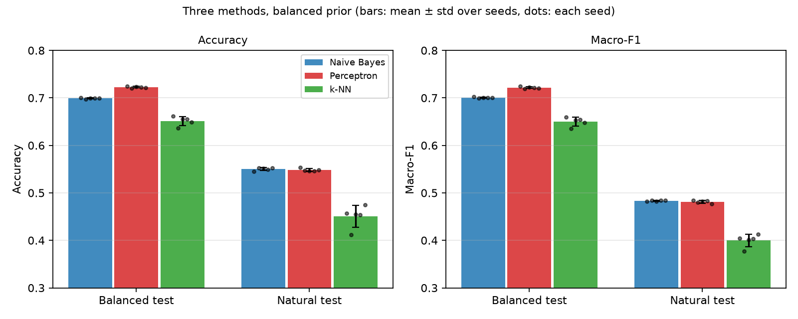
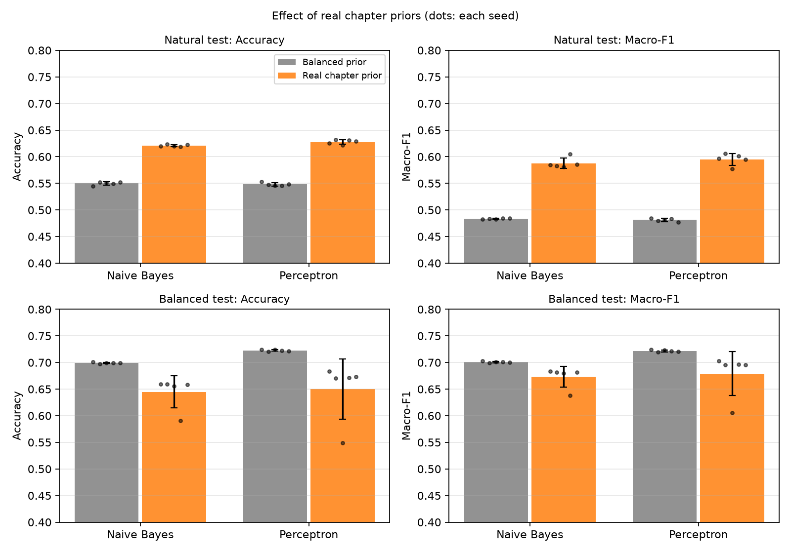
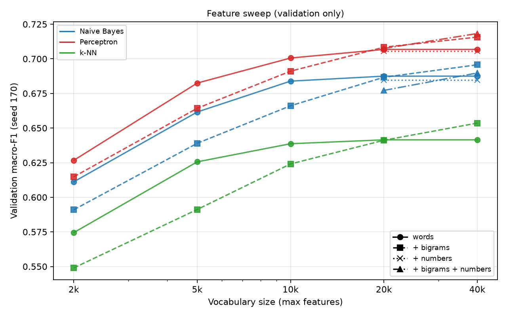
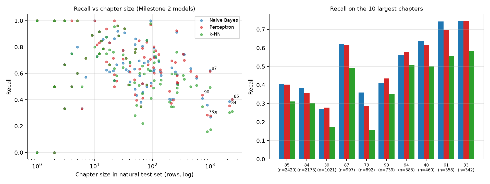
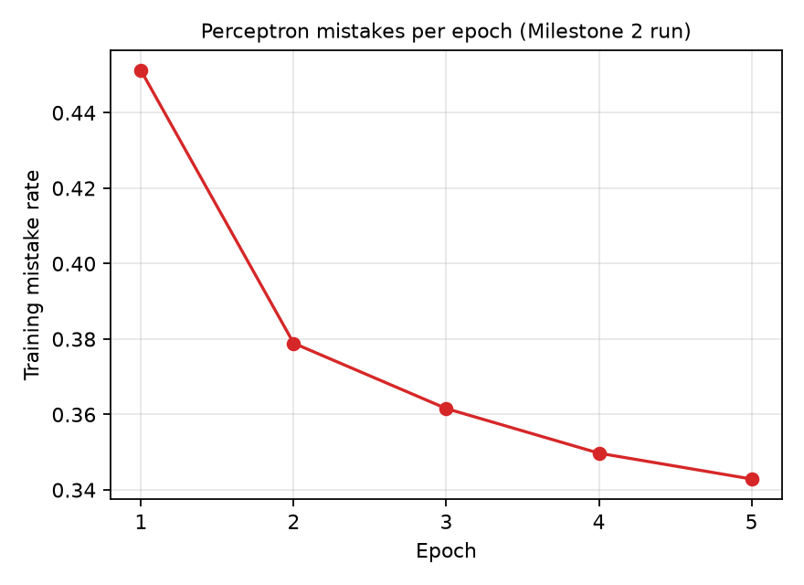
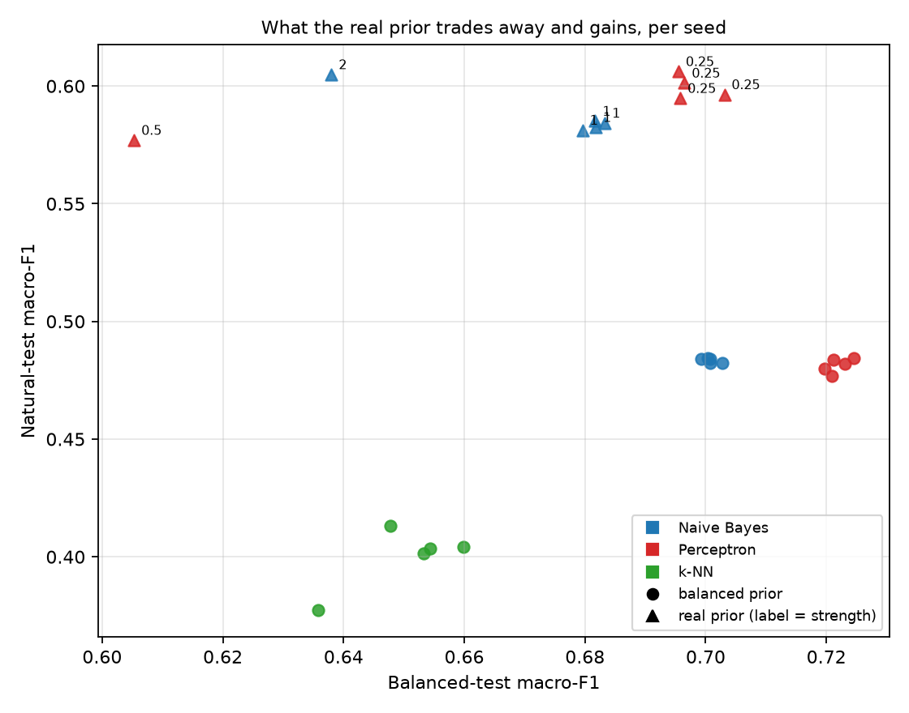

# Milestone 3: Progress Report (Team Kramer)

**Project:** Classifying Philippine Import Goods into HS Chapters from Their Descriptions  
**Repository:** https://github.com/jauntsmirk/cmsc170-project

---

## A. Progress Overview

- **All three methods implemented from scratch** (`hsclf/models.py`): Naive Bayes with Laplace smoothing, a multi-class averaged Perceptron, and cosine k-NN.
- **Metrics implemented from scratch** (`hsclf/metrics.py`): confusion matrix, accuracy, per-chapter precision/recall/F1, macro-F1, weighted F1, top-3 accuracy, and the share of dutiable value (PHP) on wrong predictions. Naive Bayes and the metrics are checked against hand computation in `tests/test_all.py`.
- **Fair, reproducible comparison runner** (`scripts/run_seeds.py`, `hsclf/experiment.py`): every method uses the same protocol. Vocabulary and idf are fitted on training text only, hyperparameters are chosen on the 2022 validation year, then the model is refit on train + validation and scored once on both 2023–2025 test sets. Results are saved after every run, so runs can be stopped and restarted.
- **Five seeds (170–174).** The seed changes which rows survive the 1,500-per-chapter training cap. The test sets are the same for every seed, so the spread measures sensitivity to the training sample.
- **Feature sweep on validation only.** Vocabulary 2,000 to 40,000, with and without bigrams, and with and without number tokens such as `#v` for "220V".
- **Real chapter priors** (`--prior real`). A Bayes-rule correction after scoring that moves the balanced model toward the real chapter mix. Its strength is chosen on the 2022 natural sample, never on the test sets.
- **Graphs and tables** (`scripts/plot_results.py`): six figures in `results/figures/` and `results/m3_comparison.md`.
- **Tests** for the runner, priors and number tokens (`tests/test_runner.py`, `tests/test_priors_numbers.py`).

---

## B. Comparison of All Methods

Five seeds, vocabulary 40,000 with bigrams, mean ± sample std. Full table with every column: `results/m3_comparison.md` and `results/seeds_summary.md`.

### B1. Balanced prior (the Milestone 2 setting)

| Method | Balanced acc | Balanced macro-F1 | Natural acc | Natural macro-F1 | Natural top-3 |
|---|---|---|---|---|---|
| Perceptron | 0.7227 ± 0.0016 | 0.7219 ± 0.0019 | 0.5480 ± 0.0030 | 0.4813 ± 0.0030 | 0.7323 ± 0.0025 |
| Naive Bayes | 0.6991 ± 0.0011 | 0.7007 ± 0.0013 | 0.5500 ± 0.0031 | 0.4834 ± 0.0010 | 0.7502 ± 0.0005 |
| k-NN | 0.6514 ± 0.0094 | 0.6502 ± 0.0091 | 0.4504 ± 0.0231 | 0.3999 ± 0.0134 | 0.6327 ± 0.0443 |

### B2. Real chapter prior (Naive Bayes and Perceptron only)

Means over the same five seeds, computed from `results/seeds.csv`. Standard deviations are in `results/m3_comparison.md`.

| Method | Balanced acc | Balanced macro-F1 | Natural acc | Natural macro-F1 | Natural top-3 |
|---|---|---|---|---|---|
| Perceptron | 0.650 | 0.679 | 0.627 | 0.595 | 0.824 |
| Naive Bayes | 0.645 | 0.673 | 0.621 | 0.588 | 0.827 |

Change from the balanced prior (percentage points):

| Method | Natural acc | Natural macro-F1 | Balanced acc | Balanced macro-F1 | Value on wrong rows (natural) | Rows predicted as ch. 01 (natural) |
|---|---|---|---|---|---|---|
| Naive Bayes | +7.1 | +10.4 | −5.4 | −2.8 | 26.8% → 20.2% | 273 → 6 |
| Perceptron | +7.9 | +11.4 | −7.3 | −4.3 | 26.8% → 20.5% | 225 → 4 |

k-NN was not run with the real prior in this milestone; it is planned for Milestone 4. Its prior can only reweight chapters already among the k neighbours, so we expect a smaller gain.

### B3. Figures



*Figure 1. Three methods, balanced prior. Bars are the mean ± std over five seeds, dots are single seeds. k-NN has the widest spread.*



*Figure 2. The real prior raises natural-test scores and lowers balanced-test scores. The two low dots are Perceptron seed 172 and Naive Bayes seed 173.*



*Figure 3. Validation macro-F1 against vocabulary size. Bigrams help only at the largest vocabularies; number tokens give no consistent gain.*



*Figure 4. Recall falls as chapter size grows (Milestone 2 models). Points at sizes 1 to 3 are too small to read.*



*Figure 5. The Perceptron still misclassifies about 34% of training rows after 5 epochs (Milestone 2 run), as expected when the data is not linearly separable.*



*Figure 6. Each point is one seed. Triangles are real-prior runs, labelled with the chosen strength.*

---

## C. Findings and Explanations

The explanations below are our reading of the results, not tested causes, unless stated.

1. **Perceptron vs Naive Bayes.** The Perceptron leads by 2.4 points on the balanced test, far beyond the seed spread (about 0.2 points). On the natural test they tie (0.2-point gap, smaller than the std), and Naive Bayes is clearly better on top-3. A plausible reason is that the Perceptron learns discriminative weights that separate similar chapters when classes are equally common, while Naive Bayes produces better-calibrated scores, which helps when ranking the top three.
2. **k-NN is last and least stable.** It is 6 to 10 points behind on every measure, its std is 5 to 10 times larger, and its best k changes with the seed (5, 15 or 30). It must find the same short, generic description among the training rows; one-word descriptions such as "SPARE PARTS" have many near-identical neighbours in several chapters.
3. **More vocabulary helped; bigrams only above the cap.** Every method gained 3.5 to 4.5 points over Milestone 2 from using the full vocabulary. Bigrams lowered scores under a 5,000 or 10,000 cap (they take slots from single words) and added about 1 point at 40,000.
4. **Number tokens: no clear gain.** Validation macro-F1 with number tokens at 40,000 and bigrams is 0.6898 (Naive Bayes) and 0.7183 (Perceptron), against 0.6957 and 0.7157 without. The differences are within about 0.6 points on a single seed, so we treat them as ties. The `--numbers 1` runs on the seeds phase are planned for Milestone 4.
5. **Real prior: a large natural-test gain at a balanced-test cost.** It raises natural accuracy by about 7 to 8 points and natural macro-F1 by about 10 to 11 points, cuts the value on wrong rows by about 6 points, and nearly removes the chapter-01 problem from Milestone 2 (273 → 6 rows for Naive Bayes). Balanced scores drop because the prior favours common chapters. Which setting is "better" depends on the use: the natural test matches real customs traffic.
6. **The prior-strength tuner picks different strengths on different seeds.** Figure 6 shows two odd runs, and they are not the same kind of problem:
   - Perceptron seed 172 chose strength 0.5 (the other four chose 0.25). It is worse than the other four on both axes (balanced macro-F1 0.605, natural 0.577), and its balanced-test value on wrong rows rose to 47.8%. This looks like a bad pick.
   - Naive Bayes seed 173 chose strength 2 (the other four chose 1). It has the lowest balanced macro-F1 of the five (0.638) but the highest natural macro-F1 (0.605). This is a trade-off point, not an error: a stronger prior favours common chapters more.

   Both strengths were picked by accuracy on the 2022 natural sample alone, which does not see the balanced-test cost, and the Perceptron's scores are not log-probabilities, so its right strength is not known in advance. Leaving seed 172 out, the Perceptron's real-prior balanced accuracy is 0.675 instead of 0.650. We report all five seeds and do not drop any.
7. **Where the models still fail.** The weakest large chapters are 39 plastics (Perceptron recall 0.28), 73 iron and steel articles (0.28), 84 machinery (0.35), 85 electrical machinery (0.40) and 90 instruments (0.44). The biggest chapters 84 and 85 are confused with each other and with 87 and 90. See `fig4_per_chapter.png`. Short part descriptions fit several of these chapters.

---

## D. Division of Tasks

| Member | Task | Can explain |
|---|---|---|
| Mark | Runner, seeds and feature sweep | `experiment.py`, `run_seeds.py`, `summarize_seeds.py` |
| Jose | Real chapter priors and number tokens | `adjust_for_prior` and `prior_log_ratio` in `models.py`, `text.py` |
| Joas | Figures, comparison table and this report | `plot_results.py` |
| Joas | Tests | `tests/` |

---

## E. Problems Encountered

- **Slow NumPy.** NumPy installed with `apt` ran about 80 times slower than pip's (5 against 418 GFLOPS on the same laptop). We now use a virtual environment.
- **k-NN cost.** One k-NN seed takes about 10 minutes on the balanced test and about 17 on the natural test. Real-prior runs for Naive Bayes took from 207 to 2,959 seconds depending on the run, so timings in `seeds.csv` are not a clean measure of method cost.
- **Zero spread for Naive Bayes.** With a fixed training set its std would be 0, so the seed now decides which rows survive the per-chapter cap.
- **Edge-of-grid settings.** In Milestone 2, 5 epochs and k = 15 sat at the edge of the grids, so the grids were widened (epochs 2, 3, 5, 10 and k 1, 5, 15, 30, 50).
- **Unstable prior strength** (Section C, item 6).
- **Label noise** in the source labels (for example chapter 01) still limits scores.
- **Test-set noise.** Gaps under about 1 point are treated as ties.

---

## F. Plan for Milestone 4

- **Learning curve** with `train_frac` (0.1, 0.25, 0.5, 1.0) to justify the sample size.
- **Chapter-01 exclusion** with `exclude_chapters=("01",)` to show what label noise costs.
- **k-NN with the real prior**, and `--numbers 1` on the seeds phase.
- **Make the prior strength stable**: choose it with a rule that also looks at balanced macro-F1, or smooth it over a larger natural sample, then rerun.
- **Optional fourth method:** Decision Tree (CART).
- **Tune and finalise**: final tables and figures, error analysis.
- **GitHub Pages project page** with all nine required sections, and the presentation slides.
- **README** with run and reproduce instructions (currently one line).

---

## G. How to Reproduce the Figures

```bash
source .venv/bin/activate
python scripts/summarize_seeds.py     # results/seeds_summary.md
python scripts/plot_results.py        # results/figures/*.png and results/m3_comparison.md
```